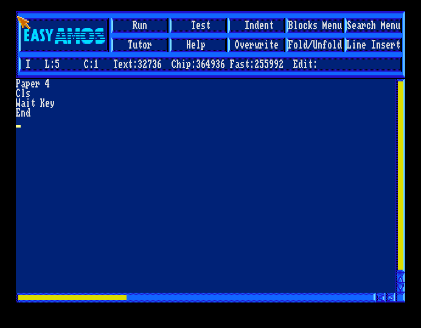
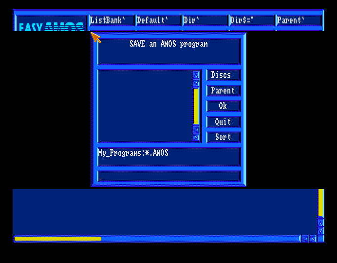
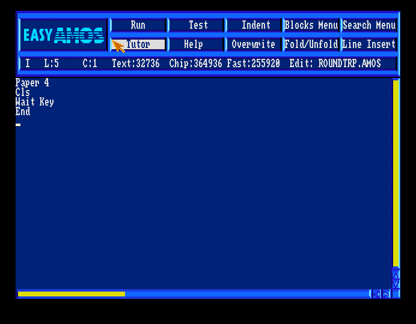

# Independent native Save comparison

FS-UAE produces the same 56-byte AMOS program and the same complete bitmap block
as the earlier Emu198x trial. The nonzero unused words are therefore produced
outside Emu198x and its export path. They are insufficient evidence of export
corruption. This supports a narrow correction to the checker in
[issue #6](https://github.com/lang198x/amos/issues/6).

[reference-save.json](reference-save.json) records identities, observation points,
checksums, allocation, hashes, inputs and capture hashes. Installed Easy 1.01,
Programs and Kickstart 1.3 have the same identities as the existing profile.

## Native comparison

FS-UAE 3.2.35 boots Programs read-only in a fresh process, with no snapshot,
PAL A500, 512 KiB chip and 512 KiB slow RAM. Its startup identifies the core as
WinUAE 3300b2. The effective configuration confirms one floppy drive and the
expected memory. Warp is used during boot and disabled before source entry.

The four source lines are typed with individual native keypresses and verified
on screen. Programs is explicitly ejected before the clean work disk is inserted
writable into the same drive. Separate input calls provide over two seconds
with an empty drive; intervals are not frame-counted. Temporary mappings are
local to the isolated configuration. Left Control maps to guest Left Amiga,
so Control+S opens the native Save selector.

| Observation point | Result |
|---|---|
| After insertion | Disk hash identical to clean baseline |
| Save selector open, before submission | Still identical to baseline; bitmap 881 |
| Native Save returns to editor | One 56-byte file, bitmap 884, checksums valid |
| Real allocation | Exactly root 880, header 882, data 883, bitmap 884 |
| Native program | Byte-identical to Emu198x file |
| Entire 512-byte bitmap | Byte-identical to Emu198x bitmap |
| Format198x 0.3.2 | Same failure at nonexistent block 2402 |

The saved filename is **ROUNDTRP.AMOS**, rather than ROUNDTRIP.AMOS: the `I`
keypress was not accepted. The result is not presented as filename-identical.
A fresh repeat with a clean work disk encountered the same input difficulty.
After bounded attempts, it was stopped before Save; its disk remained identical
to baseline. The input mechanism was not established or changed.

The filename difference changes directory metadata, but does not negate the
observed equality of the program and entire bitmap. The native file SHA-256 is
`72b16ac6f6c1a01d9274f2af68427b688f064c8b33544796d16f4674c258910a`.
The bitmap SHA-256 is
`1775673bbbbca6308df97726dc92371569f1cd87493d9f71b45235f4af723517`.
The final allocation word's two padding bits remain clear. Nonzero values occur
only in later whole words, beyond the 55-word allocation map.

These are FS-UAE's unmodified cropped guest-frame captures. Media, native
programs, snapshots and private paths are excluded. The retained private saved
image was hashed again after the emulator process exited.

## Proposed correction

The earlier [controls](bitmap-investigation.md) show that clearing only the
unused tail makes Format198x accept the image, while marking a live header free
makes both validators report failure. The native result now establishes that
the tail rule rejects bytes original software writes outside Emu198x. It does
not identify a guest buffer-reuse routine or qualify every AmigaDOS revision.

I recommend permitting nonzero **whole words after the allocation map**, while
retaining final-word padding checks, whole-block checksums and every real-block
ownership check. Preserve native image bytes and keep deterministic zero padding
in our own writer. A new strict/canonical mode is an alternative, but adds an API
and caller choice without a demonstrated need. This proposal awaits design
agreement; no checker behaviour changes here.

Use a synthetic relocated bitmap with nonzero unused words as the regression.
Keep checksum-correct corruption controls for live allocation and final-word
padding, and prove that unused bytes still participate in the checksum. Verify
both private native images through the updated consumer before completion.

Native reload/run is not repeated in FS-UAE; the earlier fresh-reader Emu198x
evidence remains separately scoped. Because FS-UAE reproduces the entire bitmap,
another Emu198x insertion/export trial is not needed to establish that this tail
can originate in native output. Parser, codec and release behaviour is unchanged.
